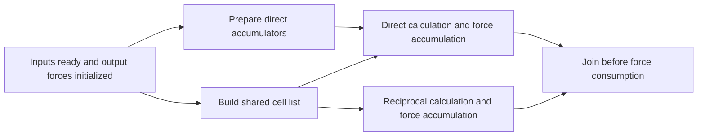

# cuPotential interaction coverage and CUDA stream scheduling

Date: 2026-11-17

Source version: 0.3.5, runtime ABI 32

Reviewed upstream commit: `fbfc4cb6282cd52d33f7adbbcbaeaa5c19b47d74`

cuPotential supplies selected bonded interactions alongside electrostatics, Lennard-Jones interactions, and custom radial pair potentials. Its runtime supports asynchronous CUDA execution, graph capture, and tuning under concurrent workloads. The supplied OpenMM plugin implements the surrounding simulation schedule, including stream dependencies, integration, constraints, and barostat operations.

Another MD engine can consume the interaction APIs directly. It must adapt the simulation schedule to its own execution lifecycle and buffer ownership.

## Interaction coverage

| Capability | Core runtime support | Application responsibility |
| --- | --- | --- |
| Electrostatics and Lennard-Jones interactions | Direct and reciprocal calculations through the pair, splitting plan, and workspace APIs. The standard pair needs at least one splitting plan. Reciprocal dispersion covers only the attractive geometric-C6 term, and LJ switching must then be disabled; see [`pair.h`](../include/cupo/pair.h#L40). | Supply parameters, matching numerical components, and energy corrections. |
| Harmonic bonds | `CUPO_TUPLES_HARMONIC_BOND` | Build interaction tuples from the engine's topology. |
| Harmonic angles | `CUPO_TUPLES_HARMONIC_ANGLE` | Supply the central atom and parameter conventions correctly. |
| Periodic torsions | `CUPO_TUPLES_PERIODIC_TORSION` | Map atom order, phase, periodicity, and coefficients. |
| Special Coulomb/LJ pairs | `CUPO_TUPLES_COULOMB_LJ_PAIR`, with no cutoff or splitting | Restore physical replacement pairs after exclusion cancellation, exactly once. |
| Custom radial pair interactions | Expression compilation or a device evaluator supplied as LTO IR, with no implicit reciprocal calculation | Supply an evaluator that is pure, repeatable, and symmetric under particle exchange, including for excluded pairs ([`pair.h`](../include/cupo/pair.h#L62)), and any matching long range treatment. |
| Other force terms | The tuple API exposes the kinds listed above | Retain the engine's implementations for additional functional forms. |

The bonded kinds and energy definitions are explicit in [`tuples.h`](../include/cupo/tuples.h#L19). Periodic torsion refers to the cosine dependence on the dihedral angle; periodic boundary treatment is controlled separately by each tuple's `use_pbc` field.

The tuples API is experimental. [`tuples.h`](../include/cupo/tuples.h#L19) opens with "Experimental interaction-tuple handle", and the [plugin README](../plugins/openmm/README.md#L20) says to expect breaking changes in the C API. Bonded support is also a runtime capability. Check that `cupo_runtime_capabilities()` reports bit `0x4` ([`version.h`](../include/cupo/version.h#L30)) before you delegate bonded terms.

Tuple atom indices are fixed when the handle is created. `cupo_tuples_update_parameters` keeps the topology, `use_pbc`, and groups ([`tuples.h`](../include/cupo/tuples.h#L115)). After OpenMM reorders atoms, the plugin remaps them with [`cupo_tuples_set_atom_mapping`](../plugins/openmm/cpp/platforms/cuda/src/bonded/GroupedBonded.cu#L172). [`detail/tuples_adapter.h`](../include/cupo/detail/tuples_adapter.h#L13) reserves that function for the OpenMM plugin and excludes it from the supported API. An engine that reorders atoms must present positions and forces in the creation order, or create the handle again; see [0001](0001_non_openmm_integration_assessment.md#particle-ordering-and-topology-changes).

The OpenMM adapter uses this backend under specific conditions. [`GroupedBonded.cu`](../plugins/openmm/cpp/platforms/cuda/src/bonded/GroupedBonded.cu#L174) batches terms into one tuples handle, always in FP32 ([line 179](../plugins/openmm/cpp/platforms/cuda/src/bonded/GroupedBonded.cu#L179)), and calls [`cupo_tuples_execute`](../plugins/openmm/cpp/platforms/cuda/src/bonded/GroupedBonded.cu#L252). The [adapter selection](../plugins/openmm/cpp/platforms/cuda/src/bonded/GroupedBonded.cu#L343) uses the stock OpenMM kernels unless all of these conditions are true:

- The System contains a plugin `NonbondedForce`.
- `CUPO_PLUGIN_BONDED` is not set to `0`.
- The precision is single or mixed.
- There is only one context.

The adapter also [sends bonded forces that request periodic boundary treatment](../plugins/openmm/cpp/platforms/cuda/src/bonded/GroupedBonded.cu#L290) to stock OpenMM. That fallback is a plugin policy. The public tuples contract includes periodic box inputs, and the plugin itself uses tuple periodic boundaries for nonbonded exception pairs ([`CudaNonbondedKernels.cu`](../plugins/openmm/cpp/platforms/cuda/src/nonbonded/CudaNonbondedKernels.cu#L1027)).

## Runtime concurrency support

The core API accepts caller supplied CUDA streams. Reciprocal execution and influence refresh enqueue work without synchronization and support graph capture; the application orders dependencies between streams. Uses of the same reciprocal workspace must be serialized. See [`kspace.h`](../include/cupo/kspace.h#L27).

Tuple execution is also asynchronous and capturable. Its contract permits concurrent streams to share a tuples handle when they use distinct output buffers. That permission does not authorize concurrent calls on the same handle writing the same destination; see [`tuples.h`](../include/cupo/tuples.h#L140).

Each API has further ordering rules:

- Calls on the same direct space workspace must not overlap ([`dspace.h`](../include/cupo/dspace.h#L39)). Run prepare, execute, and finish in that order, with the same energy and force flags for prepare and execute ([`dspace.h`](../include/cupo/dspace.h#L169)).
- Keep the cell list, box, and weights unchanged through reciprocal interpolation ([`kspace.h`](../include/cupo/kspace.h#L38)). Keep the cell list's device inputs unchanged until its queued work completes ([`cell_list.h`](../include/cupo/cell_list.h#L104)). The join must therefore come before any writer of positions, box, weights, or parameters.
- Create tuples handles outside capture ([`tuples.h`](../include/cupo/tuples.h#L100)). Update and destroy them outside capture, with no outstanding work that uses the handle ([line 116](../include/cupo/tuples.h#L116), [line 128](../include/cupo/tuples.h#L128)).
- Tuple execution never clears its force or energy outputs ([`tuples.h`](../include/cupo/tuples.h#L160)).

The runtime also exposes `cupo_dspace_tune_with_kspace` and `cupo_dspace_tune_with_kspaces`. These startup hooks choose the direct space kernel by timing it while reciprocal work runs, including their join. They require a shared cell list and prepared reciprocal state, and execute outside capture. They select a kernel for the workspace lifetime; they do not install the engine's production stream schedule. See [`dspace.h`](../include/cupo/dspace.h#L121).

## Scheduling in the OpenMM plugin

The plugin's [`dispatchStep`](../plugins/openmm/cpp/platforms/cuda/src/nonbonded/CudaNonbondedKernels.cu#L1550) coordinates direct, reciprocal, and miscellaneous streams. Its steady execution dependencies are:

Preparation can overlap cell list construction. After the list is ready, direct and reciprocal calculations can overlap. Both add their forces into one fixed point buffer, and their energy scalars stay separate. A plugin comment states that the two force outputs "use the same fixed64 atomics and therefore commute" ([`CudaNonbondedKernels.cu`](../plugins/openmm/cpp/platforms/cuda/src/nonbonded/CudaNonbondedKernels.cu#L1597)). This is plugin knowledge of runtime internals. No public header uses the word atomic; the headers state only that forces accumulate ([`kspace.h`](../include/cupo/kspace.h#L288), [`dspace.h`](../include/cupo/dspace.h#L196)). The grouped bonded terms also add into the same OpenMM force buffer while the nonbonded work runs ([`GroupedBonded.cu`](../plugins/openmm/cpp/platforms/cuda/src/bonded/GroupedBonded.cu#L253)).

Bonded work has its own placement in this schedule. [`CUPO_PLUGIN_BONDED_SCHEDULE`](../plugins/openmm/cpp/platforms/cuda/src/nonbonded/CudaNonbondedKernels.cu#L630) accepts `overlap`, `after-sort`, or `auto`. The default, `auto`, resolves to `after-sort` for Standard forces and to `overlap` for Custom mode or a cutoff expression ([line 637](../plugins/openmm/cpp/platforms/cuda/src/nonbonded/CudaNonbondedKernels.cu#L637)). With `after-sort`, the bonded work waits for cell list sorting. The plugin creates that event only when graphs are on ([line 644](../plugins/openmm/cpp/platforms/cuda/src/nonbonded/CudaNonbondedKernels.cu#L644)).

The [grouped bonded hook](../plugins/openmm/cpp/platforms/cuda/src/bonded/GroupedBonded.cu#L272) runs before the deferred nonbonded join. Bonded evaluation overlaps the nonbonded work only on steps that replay a captured graph. Graphs are on by default, and the nonbonded capture starts after 50 warm-up evaluations ([line 1526](../plugins/openmm/cpp/platforms/cuda/src/nonbonded/CudaNonbondedKernels.cu#L1526)). On eager steps, the nonbonded work runs on OpenMM's stream ([line 1476](../plugins/openmm/cpp/platforms/cuda/src/nonbonded/CudaNonbondedKernels.cu#L1476)) and joins before the bonded work starts.

The plugin also supplies the Langevin integrator. [`CudaLangevinMiddleKernel.cu`](../plugins/openmm/cpp/platforms/cuda/src/integrator/CudaLangevinMiddleKernel.cu#L41) holds its launchers. The kernel bodies for the integration parts, center-of-mass removal, SETTLE, and SHAKE are in [`Constraints.cuh`](../plugins/openmm/cpp/platforms/cuda/src/integrator/Constraints.cuh). The integrator implements only SETTLE and SHAKE, and it [rejects constraints that need CCMA](../plugins/openmm/cpp/platforms/cuda/src/integrator/CudaLangevinMiddleKernel.cu#L802). The same file holds the [whole step graph eligibility](../plugins/openmm/cpp/platforms/cuda/src/integrator/CudaLangevinMiddleKernel.cu#L845) and its [execution](../plugins/openmm/cpp/platforms/cuda/src/integrator/CudaLangevinMiddleKernel.cu#L1159). Its Monte Carlo barostat is another [plugin component](../plugins/openmm/cpp/platforms/cuda/src/barostat/CudaBarostatKernel.cu). These implementations are present in the repository source, while the public core API exposes interaction primitives rather than a general standalone simulation loop.

## Implications for another MD engine

An integration can delegate both supported bonded and nonbonded calculations to cuPotential, or delegate only the expensive force components and retain the engine's other kernels. The engine owns the topology conversion, device storage, and scheduling dependencies in either case. Bonded delegation also depends on the experimental tuples API and on a fixed atom order, as described above.

Start with a single stream to establish force and energy agreement. Then schedule independent producers concurrently, with an explicit join before the integrator, any other force consumer, and any writer of positions, box, weights, or parameters. Apply each API's workspace and output buffer rules rather than assuming that every handle can be reused concurrently.

The public headers do not state that concurrent producers may add into one force buffer. Give each producer its own buffer and combine the buffers after the join. Alternatively, compare the forces of a single-stream run and a concurrent run before you rely on a shared buffer.

Adapting the plugin's performance mechanisms requires the destination engine's equivalents for atom ordering, force initialization, event ordering, energy reduction, and graph lifetime. Copying its kernel calls alone does not reproduce the scheduling benefits. Measure the complete timestep, including the engine's remaining force calculations and adapter overhead.

The [integration assessment](0001_non_openmm_integration_assessment.md) covers data conversion, virial support, and distributed execution requirements. The [speedup mechanisms note](0003_speedup_theory_and_mechanisms.md) discusses the possible contribution of numerical and scheduling changes to the reported performance.
